<h1 align="center">PKTool</h1>

<p align="center">
  <b>A Pokémon save editor that runs on the Nintendo DS itself.</b><br>
  Edit, create, legality-check and legalize Pokémon of the Gen I to V games (Red/Blue/Yellow, Gold/Silver/Crystal,<br>
  Ruby to Emerald, FireRed/LeafGreen, Diamond to SoulSilver, Black/White 1-2), keep them in a Bank<br>
  and move them between your games — offline, on the console, no PC needed.
</p>

<p align="center">
  <a href="https://github.com/pioacosta/PKTool/releases/latest"></a>
</p>

<p align="center">
  
  
  
  
</p>

<p align="center">
  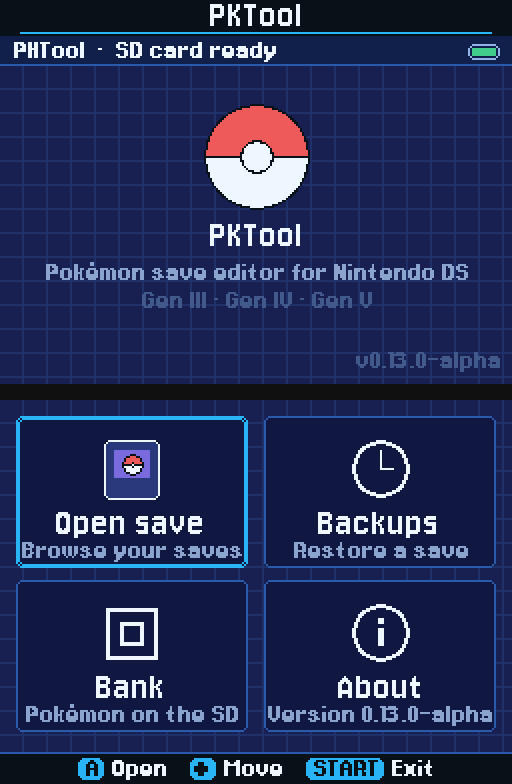
  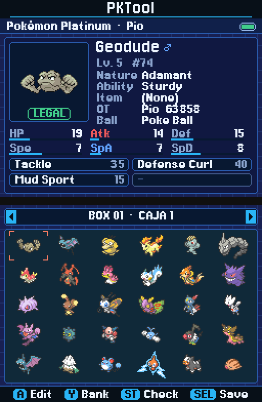
  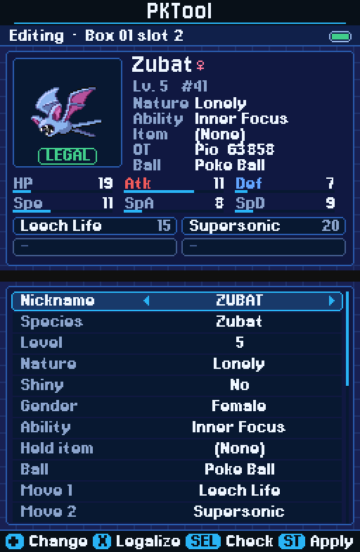
</p>

PKTool opens the `.sav` files on your flashcart's SD card and lets you browse
your party and boxes, edit any Pokémon, create new ones, see whether they are
legal and fix them with one button. It re-implements the relevant parts of
[PKHeX](https://github.com/kwsch/PKHeX) in small C++ that fits in the DS's
4 MiB of RAM, with a dual-screen interface in the style of
[PKForge](https://github.com/sofianeelhor/PKForge).

> Not affiliated with Nintendo, Game Freak or The Pokémon Company.

## Download

Get `PKTool.nds` from the **[latest release](https://github.com/pioacosta/PKTool/releases/latest)**
(Assets → `PKTool.nds`). Copy it to the SD card of your flashcart and start it
from the flashcart's menu (on a DSi, also through TWiLight Menu++). PKTool
searches the card for Pokémon `.sav` files, so keep your saves on the same card
— and everything it writes is backed up first, in `/PKTOOL/backups`.

## Features

**Saves**
- Finds every Pokémon save on the SD card (other games' saves are skipped) and
  shows each one with its game's box-art legendary, trainer and party.
- Party, all boxes and box names of every supported game; the exact version is
  worked out even for paired games (Diamond or Pearl, Ruby or Sapphire...).
- Safe writing: backup → checksums → validation → temporary file → read-back →
  replace. If any step fails, the original save is untouched.
- Automatic backup before every write, manual backups, and restore.

**Editor**
- Nickname (on-screen keyboard), species, level, nature, shininess, gender,
  ability (including hidden abilities in Gen V), held item, ball, moves, IVs,
  EVs, friendship and egg cycles.
- Original trainer (name, gender, TID, SID), met location, level and date, egg
  location and date, fateful encounter and Pokérus (with the games' rules for
  strain and days); only the fields each generation really has are shown.
- Changing nature, shininess, gender or ability keeps the Pokémon consistent:
  a new PID and IVs are generated the way the game's RNG would.
- Battle stats are recalculated live; export any Pokémon as a Showdown set.

**Legality checker**
- A **LEGAL / CHECK / ILLEGAL** badge on every Pokémon and a detailed report.
- Checks where and at which level it was met against the real encounter
  tables of each game, its moves against the learnsets, the PID/IV
  correlation (Method 1/J/K, Cute Charm, Poké Radar chain shinies, HG/SS
  Pokéwalker courses), ability, gender, ball, evolution level, EVs, PP, eggs,
  events (Wonder Cards, the Ranger Manaphy egg, Gen III distributions) and
  Colosseum/XD origins (Shadow Pokémon party locks and Poké Spot PIDs
  included; Add > Event can create them for the save's trainer IDs).
- Conservative: something is only illegal when it is impossible; what cannot
  be verified is a warning.

**LEGALIZE**
- One button fixes everything it can without touching what you asked for
  (species, level, nature, shininess, gender, ability, moves, item).
- Gives the Pokémon a real encounter from its game, or makes it hatch from a
  Day-Care egg, or brings it from an older game through Pal Park or Poké
  Transfer — and tells you exactly what would work when nothing does
  ("Mewtwo is only found from Lv. 70: raise its level").
- Uses a lead with Synchronize or Cute Charm when that gives the closest IVs
  for a wild encounter, and says which lead to bring.

**Creating Pokémon**
- **New Pokémon:** pick a species and it is legal right away.
- **Showdown sets:** import sets from `.txt` files; they are legalized on import.
- **Wonder Cards:** the 247 Gen IV and 700 Gen V Pokémon event cards,
  received the way the games do, with a met date inside the event's real
  distribution period; Gen IV saves also offer the Pokémon Ranger Manaphy egg.
  Your own card files (`.pgt`, `.pcd`, `.pgf`) in `/PKTOOL/events/` are listed
  too.
- **Gen III events:** 123 distributions for Gen III saves (Wishmaker, Channel
  and Tanabata Jirachi, Mew, the 10th Anniversary legendaries...), plus the
  54 event eggs (Pokémon Box, Pokémon Center Japan 5th Anniversary, Wish and
  PokéPark eggs) and the Pokémon Center New York (50) and Japan (58) machine
  gifts, generated with each event's own PID/IV method.
- **Eggs** from the Day-Care, hatching in the game.

**Bank and transfers**
- 20 boxes on the SD card shared by all your saves.
- Deposit and withdraw from boxes and the party; move Pokémon inside the Bank.
- Name the Bank boxes, release Pokémon, search (species name, shiny only, game)
  and sort a box or the whole Bank (Dex number, name, level) from the Bank menu (Y).
- **Gen I / II** (Game Boy `.sav`, 32 KiB, Japanese too): boxes, party, editor with DVs and Stat Exp, new
  Pokémon, Day-Care eggs, Showdown sets, legality and LEGALIZE; **Time Capsule** between Gen I and II through the
  Bank, with the bags and Korean Gold/Silver text; tested with synthetic saves only (no real Gen I/II save yet).
- Moving to a newer game follows the official paths: **Pal Park** (Gen III →
  IV) and **Poké Transfer** (Gen IV → V). Pokémon never go back, and eggs
  cannot be transferred, as in the games.
- A Pokémon only leaves the Bank once the save holding it is written, so a
  failed or cancelled write never loses one.

## Supported games

| Generation | Games | Features |
|---|---|---|
| I | Red, Blue, Yellow (also Japanese) | Editor, legality, LEGALIZE, creating, Bank, Time Capsule (synthetic saves only) |
| II | Gold, Silver, Crystal (also Japanese; Korean Gold/Silver) | Editor, legality, LEGALIZE, creating, Bank, Time Capsule (synthetic saves only) |
| III | Ruby, Sapphire, Emerald, FireRed, LeafGreen | Editor, legality, LEGALIZE, creating, Bank, Pal Park |
| IV | Diamond, Pearl, Platinum, HeartGold, SoulSilver | Everything, including Gen IV Wonder Cards |
| V | Black, White, Black 2, White 2 | Everything, including hidden abilities and Gen V Wonder Cards |

## Screenshots

<p align="center">
  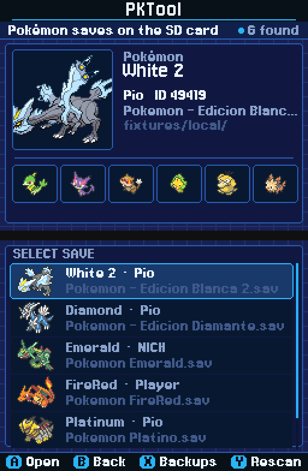
  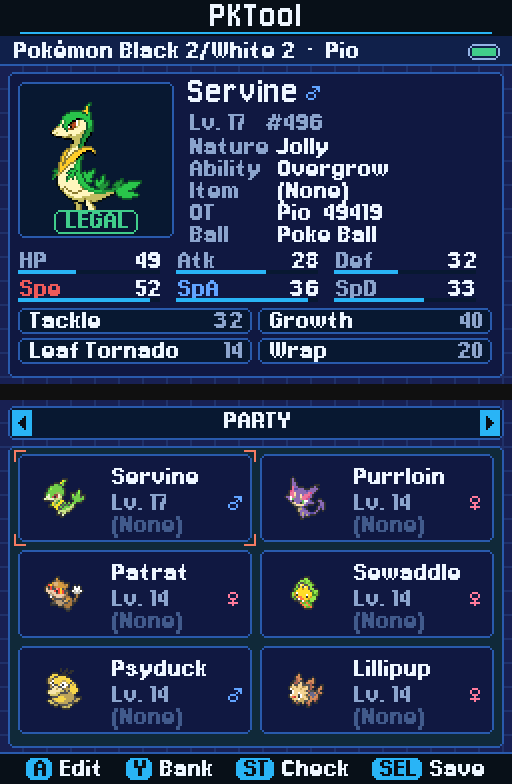
  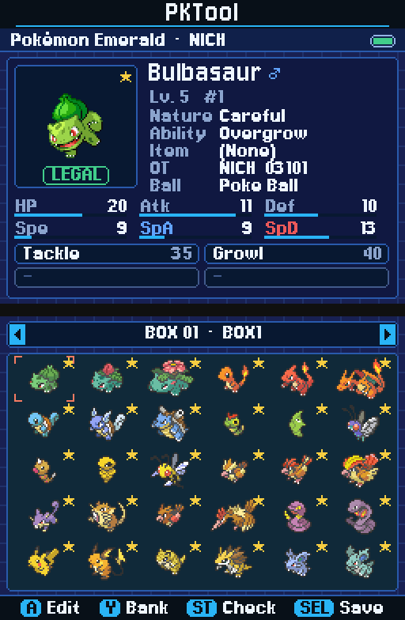
</p>
<p align="center">
  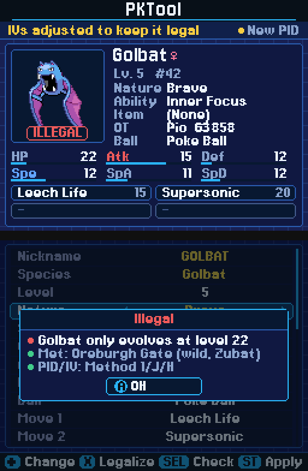
  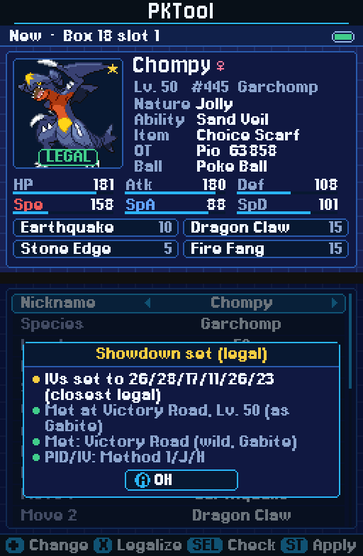
  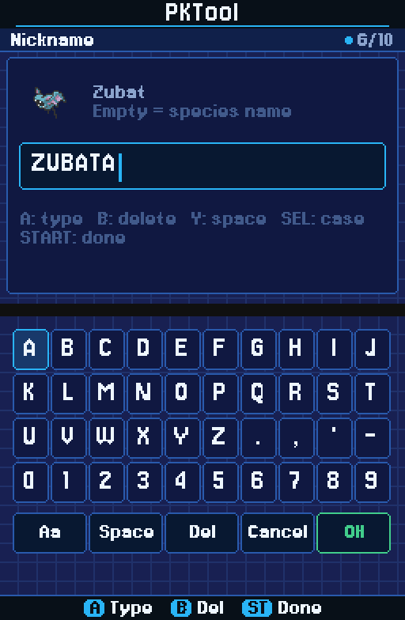
</p>
<p align="center">
  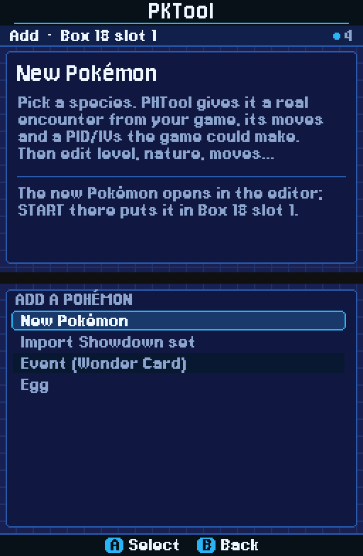
  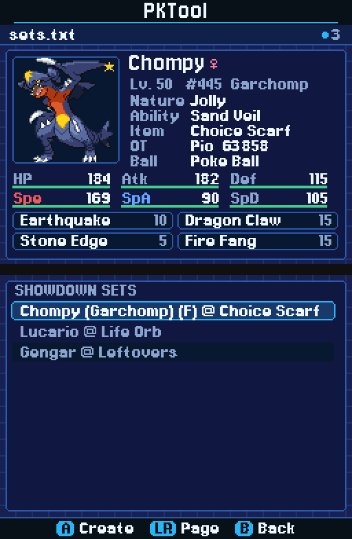
  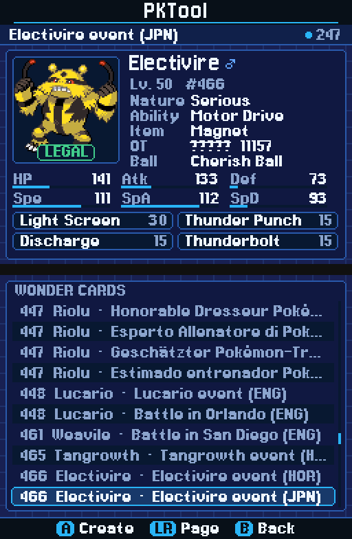
</p>
<p align="center">
  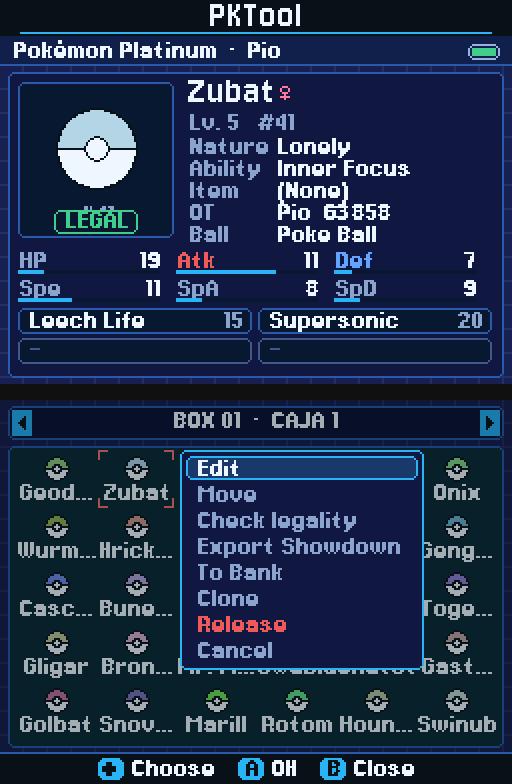
  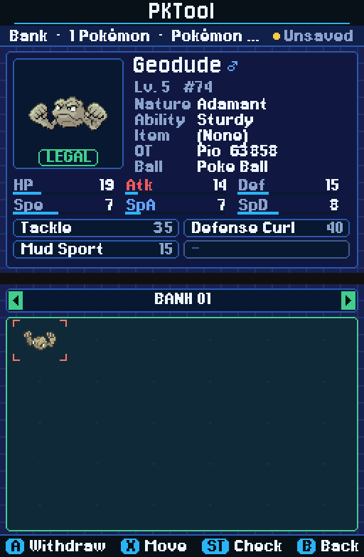
</p>
<p align="center">
  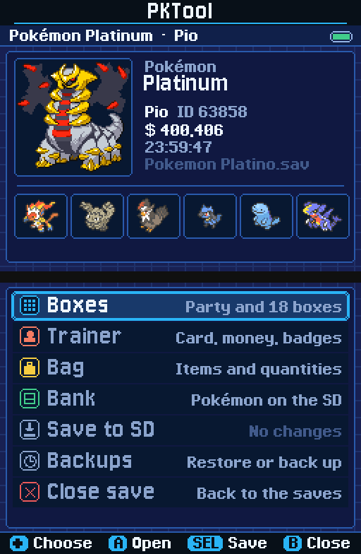
  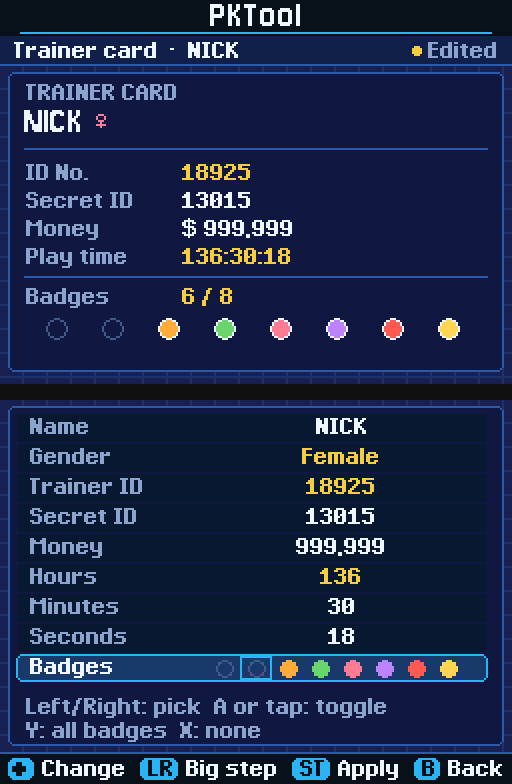
  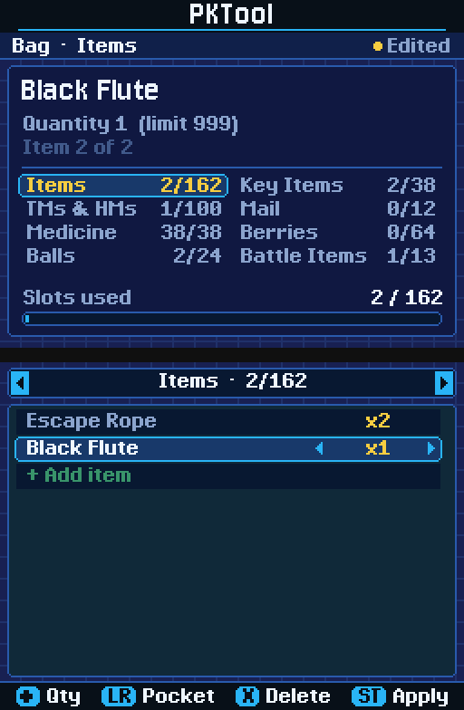
</p>

## How to use it

Open a save from the main menu and the **save menu** appears, like the main
menu of the game: *Boxes*, *Trainer*, *Bag*, *Bank*, *Save to SD*, *Backups*
and *Close save* (the top screen shows the trainer card summary and the game's
legendary; "Unsaved" shows in the corner while there are changes not yet
written). B inside Boxes, Trainer, Bag, Bank or Backups comes back to it; B on
the menu closes the save. In the box view the top screen shows the selected
Pokémon; the bottom screen is where you move around. Everything also works
with the stylus: tap tiles, list rows and slots (tap again to open), the box
arrows, the box name, the keyboard and the button hints.

| Screen | Controls |
|---|---|
| Main menu | Open save · Backups · Bank · Settings · START: exit |
| Settings | Up/Down: option (option lists, new level, names language, animations on/off, about) · Left/Right (or A): change · L/R: ±10 (level) or next language · A on About: version info · B: back (writes `settings.ini` if something changed) |
| Save browser | A: open · X: backups of this save · Y: rescan · B: back |
| Save menu | Up/Down: choose (or tap a row) · A: open · SELECT: write the save · B: close the save (asks first if there are unsaved changes) |
| Boxes | D-pad: move · L/R: party / boxes · A: slot menu (add on an empty slot) · Y: Bank · START: legality report · SELECT: write the save · tap the box name: rename it · B: back to the save menu |
| Backups | Up/Down: choose · A: restore · X: back up now · B: back |
| Trainer card | Up/Down: field · Left/Right: ±1 (money ±100, Gender: switch) · L/R: big step (±1000 IDs, ±10 000 money, ±10 time) · A: type the name / warn about IDs / toggle the selected badge · Y / X: money or badges maximum / minimum · tap a badge to toggle it · START: apply · B: back (asks if edited) |
| Bag | L/R (or the header arrows): pocket · Up/Down: slot · Left/Right: quantity ±1 · A: +10 on an item, or open the item list on "+ Add item" · Y: maximum · X: delete the item · START: apply · B: back (asks if edited) |
| Item list | Up/Down: item · L/R: ±10 · A: add it with quantity 1 · B: back |
| Slot menu | Up/Down: choose · A: confirm (or tap an item) · B: close; while moving: D-pad, L/R: target · A: drop · B: cancel |
| Ribbons | Up/Down: ribbon · L/R: page · A: toggle a ribbon (or raise a Gen III contest rank) · Left/Right: set / clear a ribbon, or lower / raise a rank · Y / X: all / no ribbons · tap a row to toggle it (ranks: tap the arrows) · START: apply · B: back (asks if edited) |
| Editor | Up/Down: field · Left/Right: ±1 · L/R: ±10 · Y: max · A: toggle / keyboard / export · X: LEGALIZE · SELECT: legality report · START: apply · B: cancel |
| Keyboard | A: type · B: delete · Y: space · SELECT: next page (upper / lower / symbols (♂ ♀); Japanese and Korean targets also get hiragana, katakana and Hangul jamo pages first: ﾞ ﾟ add dakuten, jamo compose into syllables, B/Del decomposes) · START: done |
| Add lists | Up/Down: move · Left/Right: ±10 · L/R: next/previous initial letter (A-Z order) or ±10 (Dex order) · Y (species list): switch A-Z / Dex order (saved in `settings.ini`) · A: create · B: back |
| Bank search | Up/Down: Name / Shiny / Game / Search · A on Name: type (may stay empty) · Left/Right (or A): change Shiny or Game · A on Search: run it (needs a name or a filter) · in the results A jumps to the slot, B returns to the filters |
| Bank | D-pad: move · L/R: Bank box · A: deposit / withdraw · X: pick up / drop · Y: menu (rename box, release, search, sort) · tap the box name: rename it · START: legality report · B: back |

**Editing.** Press A on a Pokémon, change what you want and press START to
apply. Nothing is written to the SD card until you press SELECT in the save
view — and the save is backed up first.

**Legality.** The badge on the summary tells you at a glance; START (SELECT in
the editor) opens the full report. If something is wrong, press **X** in the
editor to LEGALIZE: the report lists what changed and anything that is still
impossible.

**Adding Pokémon.** Press A on an empty box slot and choose *New Pokémon*,
*Import Showdown set*, *Event (Wonder Card)* (Gen III saves list the old
distributions instead) or *Egg*. The new Pokémon opens in
the editor; START puts it in the slot.

**Showdown sets.** Put `.txt` files in the Showdown export format (several
sets per file, separated by a blank line) in `/PKTOOL/showdown/`. The editor's
last row, *Showdown*, appends the current Pokémon to
`/PKTOOL/showdown/export.txt`.

```text
Chompy (Garchomp) (F) @ Choice Scarf
Ability: Sand Veil
Level: 50
Shiny: Yes
EVs: 4 HP / 252 Atk / 252 Spe
Jolly Nature
- Earthquake
- Dragon Claw
- Stone Edge
- Fire Fang
```

**Slot menu.** A on a Pokémon opens a small menu next to it: Edit, Move, Check
legality, Export Showdown (not for eggs), To Bank (same as Y), Clone (to the
first empty box slot), Ribbons, Release (asks first; never offered for the last party
member) and Cancel. Move picks the Pokémon up: change box with L/R (or go to
the party), then A drops it on a slot, swapping with the occupant, or B puts it
back. A party member cannot be moved out if it is the last one. Everything stays
in memory until SELECT writes the save.

**Ribbons.** *Ribbons* in the slot menu lists every ribbon of the save's format (80 in Gen IV and Gen V: the Sinnoh,
Hoenn and Sinnoh contest sets; 17 in Gen III, whose five contest ribbons are ranks from None to Master) with a
checkbox or rank, a dot overview and the ribbon count on the top screen. Only the game's own limits apply, not
PKHeX's ribbon legality. START applies the change to the Pokémon in memory (the checksum is refreshed and no other
byte changes); eggs have no ribbons.

**Trainer card and bag.** Both are rows of the save menu. The *Trainer* screen shows the card on the top screen and lets
you change the name, gender, Trainer ID / Secret ID, money, play time and badges
(8, or 16 in HeartGold/SoulSilver). Changing an ID makes every Pokémon already
in the save count as traded, which is why the screen warns about it. The *Bag*
screen has one tab per pocket (the pockets of the game, no PC items): change
quantities (limited to what the game allows), add items from the list of what
the pocket normally holds, or delete them. Only the game's own limits are
enforced, not legality: a save may hold an item twice, HMs by the dozen or an
item in the "wrong" pocket (any real item of the game is accepted). START
applies the edit to the save in memory through the checked setters: if a value
is beyond what the game can store (for example 999 of an item that allows 99)
the reason is shown and nothing changes; such quantities are shown in red and
come down to the limit with the first Left/Right press. Money, play time and
the name are limited the same way. SELECT then writes the save as usual.

**Bank.** In a save, press Y on a slot: on a Pokémon, pick an empty Bank slot
and press A to deposit it; on an empty slot, pick a Bank Pokémon and press A
to withdraw it there. Pokémon from an older game are converted on the way
(Pal Park, Poké Transfer). SELECT writes the Bank and the save together. The
Bank tile of the main menu and the Bank row of the save menu show the Bank for
viewing and moving Pokémon around in it (deposits and withdrawals use Y in Boxes).

**Backups.** Main menu → Backups (or X in the save browser, or *Backups* in the
save menu) lists the backups of each save and restores any of them; X there
makes a backup right now.

**Settings.** Main menu → Settings: the order of the option lists in the editor
and the Add list (A-Z by name, or by ID), the level of new Pokémon and the
language of the names (English, 日本語, Français, Italiano, Deutsch, Español,
한국어). They are kept in `/PKTOOL/settings.ini`. Backups before every write are
always made. Male and female signs (♂ ♀) show in names, the editor and the
summary; the keyboard types them on its third page (SELECT cycles ABC / abc /
symbols).

**Japanese and Korean.** Nicknames and trainer names of Japanese and Korean
saves (kana, kanji, Hangul) are drawn with a 12 px pixel font that is read from
the `.nds`'s NitroFS only when such a character appears. The language of the
names changes the species, move, ability, nature, item and ball names, how they
are sorted (accents fold, kana by gojūon row, Hangul by initial consonant) and
the species name given to Pokémon you create for a save of that language;
Showdown text stays English. The language packs live in NitroFS too, so
a loader without NitroFS needs `lang/` and `fonts/` copied to `/PKTOOL`.

**Wonder Card files.** Put Gen IV `.pgt` / `.pcd` files or Gen V `.pgf` files in
`/PKTOOL/events/` and they appear at the end of Add > Event (marked "(file)").
Files that are not a Pokémon card (items, rules, Pass Powers, eggs), cards for
the other generation and damaged files are listed greyed with the reason. A card
that is not one of the built-in distributions is received normally, but the
legality report says the event is not in the database. Gen III has no card files.

**Animations.** Screens fade in, the selection bar glides between rows and the
selected Pokémon bobs. Settings > Animations turns them off.

PKTool keeps its files in `/PKTOOL` on the SD card: `backups/`, `bank/bank.pkb`,
`showdown/`, `events/` and `settings.ini`.

## Building and credits

PKTool is written in C++17. The DS version is built with
[devkitPro](https://devkitpro.org/) (devkitARM, libnds, libfat, libfilesystem);
the same core is built and tested on a PC with CMake, and GitHub Actions builds
`PKTool.nds` and runs the test-suite on every push.

### Credits

- [PKHeX](https://github.com/kwsch/PKHeX) by Kaphotics and contributors — save
  formats, game data and legality rules (GPLv3).
- [PKForge](https://github.com/sofianeelhor/PKForge) — product inspiration and
  interface style.
- [PKSM](https://github.com/FlagBrew/PKSM) — the original on-console save manager.
- [PokeAPI/sprites](https://github.com/PokeAPI/sprites) — Pokémon sprites (box icons, summary sprites
  and the egg). The artwork belongs to Nintendo, Game Freak and The Pokémon Company.
- [Bulbapedia](https://bulbapedia.bulbagarden.net/) — the distribution periods of the Wonder Card and
  event Pokémon (`tools/fetch_event_dates.py`), used under CC BY-NC-SA 2.5.
- [Jersey 10 and Jersey 15](https://fonts.google.com/specimen/Jersey+15) — UI fonts (SIL Open Font License).
- [Ark Pixel Font](https://github.com/TakWolf/ark-pixel-font) (TakWolf, 12 px, Japanese
  variant) — kana, kanji and symbols, and [Galmuri11](https://github.com/quiple/galmuri)
  (Lee Minseo) — Hangul; both SIL Open Font License 1.1 (texts in `third_party/fonts`).
  Only the glyphs the games can show were converted (`tools/gen_cjk_font.py`).

PKTool is licensed under the GPLv3 (see [LICENSE](LICENSE)). Pokémon and all
related names and artwork are trademarks of Nintendo, Game Freak and The
Pokémon Company.
